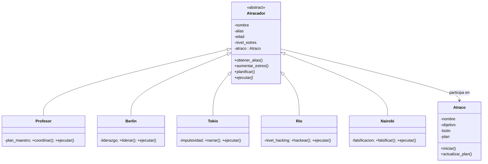

# La Casa de Papel – Ejercicio de POO (Python)

Implementación del diagrama de clases dibujado a mano: `Atracador` (abstracta) con sus subclases y la clase `Atraco` con la relación **participa en**.



## Los 4 pilares

| Pilar | Dónde |
|---|---|
| Abstracción | `Atracador` es abstracta (`ABC`) y obliga a implementar `ejecutar()` |
| Encapsulación | Atributos con `_`, propiedades de solo lectura, estrés limitado a 100, validaciones, `participantes` devuelve una copia |
| Herencia | `profesor.py`, `berlin.py`, `tokio.py`, `rio.py` y `nairobi.py` heredan de `Atracador` |
| Polimorfismo | Cada subclase sobrescribe `ejecutar()`; `Atraco.iniciar()` lo llama sin conocer la clase concreta (`profesor.py` también sobrescribe `planificar()`) |

## Ejecutar

```bash
python main.py
python -m unittest discover -s tests -t .
python -m pytest
```